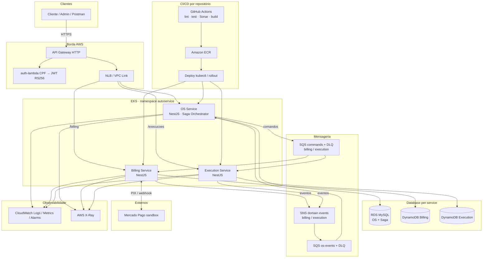
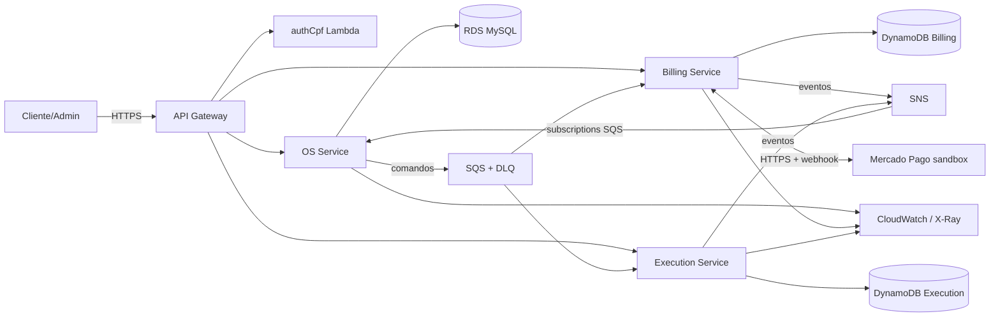
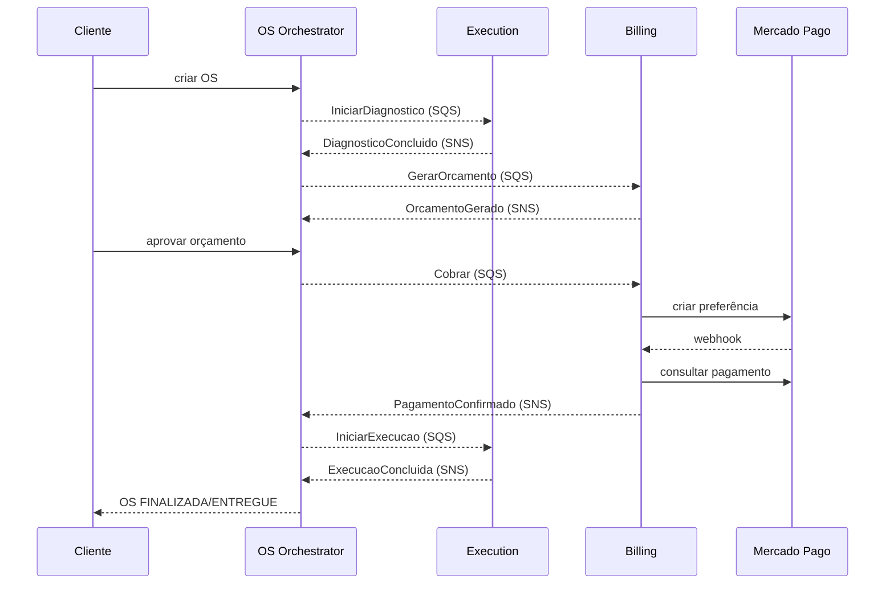
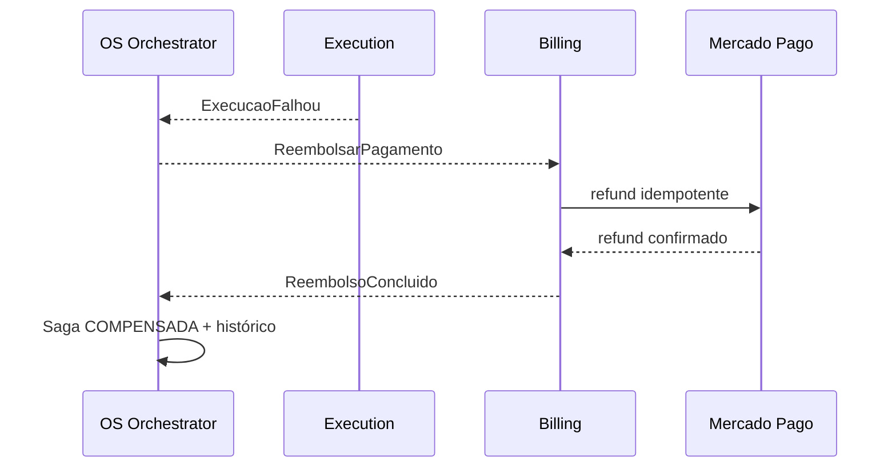
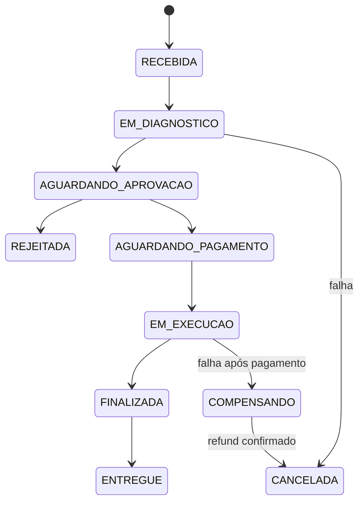
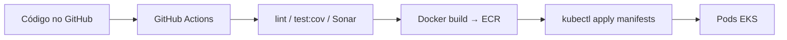

# Diagramas — Fase 4

Fonte arquitetural: [solution-design-fase4.md](./solution-design-fase4.md).  
Diagrama canônico para o **PDF do portal**: seção [Diagrama Geral de Arquitetura](#diagrama-geral-de-arquitetura).

---

## Diagrama Geral de Arquitetura

Visão completa da solução distribuída: entrada, microsserviços, bancos, mensageria, pagamentos, CI/CD e observabilidade.

### Legenda rápida

| Elemento | Papel |
|---|---|
| OS Service | Dono da OS, histórico e **orquestrador da Saga** (MySQL) |
| Billing | Orçamento, pagamento PIX, refund; único boundary Mercado Pago (DynamoDB) |
| Execution | Fila de diagnóstico/reparo/cancelamento (DynamoDB) |
| SQS / SNS | Comandos ponto a ponto e eventos desacoplados; DLQ em ambos os lados |
| auth-lambda | Autenticação CPF; leitura restrita do RDS (legado Fase 3) |
| CI/CD | Pipeline, imagem e rollback **independentes** por microsserviço |

### Repositórios

| Repo | Artefatos |
|---|---|
| `autoservicemanager-app` | Código OS, Saga, `Dockerfile`, `k8s/`, Postman, docs |
| `autoservicemanager-billing` | Código Billing, `Dockerfile`, `k8s/billing.yaml` |
| `autoservicemanager-execution` | Código Execution, `Dockerfile`, `k8s/execution.yaml` |
| `autoservicemanager-auth-lambda` | Lambda auth + notify |
| `autoservicemanager-infra-db` | Terraform VPC/RDS/DynamoDB |
| `autoservicemanager-infra-k8s` | Terraform EKS/APIGW/SQS/SNS/IRSA/obs |

---

## Componentes e trust boundaries

## Saga — caminho feliz

## Compensação após pagamento

## Estados resumidos

## Deploy e artefatos por serviço

Inventário: [artifacts-fase4.md](../delivery/artifacts-fase4.md).
