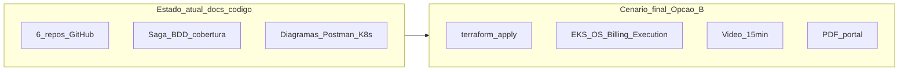
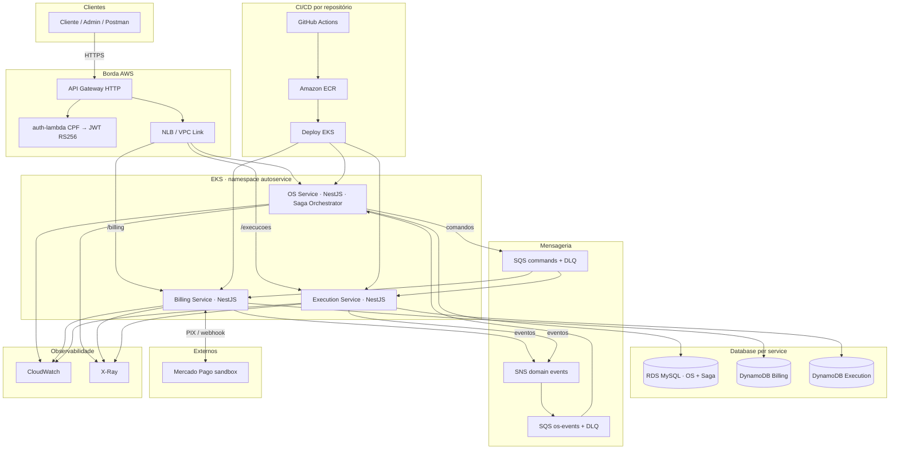

# Tech Challenge — Fase 4 · Documento de entrega (portal)

**Curso:** FIAP · Arquitetura de Software  
**Produto:** Auto Service Manager  
**Escopo:** microsserviços, Saga, SQL+NoSQL, Mercado Pago, CI/CD Kubernetes  
**Versão do documento:** 2026-11-14 (P4 — antecipação do cenário final Opção B)

> Este arquivo é a **fonte canônica** para exportar o PDF do portal.  
> Campos `[PREENCHER]` são os únicos pendentes do time (participantes + link do vídeo).  
> O restante descreve o **cenário final alvo** da entrega, com o que já está implementado e o que completa a Opção B (AWS ao vivo).

---

## 1. Identificação dos participantes

| Nome | RM | Turma |
|---|---|---|
| [PREENCHER] | [PREENCHER] | [PREENCHER] |
| [PREENCHER] | [PREENCHER] | [PREENCHER] |
| [PREENCHER] | [PREENCHER] | [PREENCHER] |
| [PREENCHER] | [PREENCHER] | [PREENCHER] |

---

## 2. Links dos repositórios e do vídeo

| Item | URL | Status |
|---|---|---|
| OS Service | https://github.com/dinhogt/autoservicemanager-app | Publicado (`develop` / `master`) |
| Billing Service | https://github.com/dinhogt/autoservicemanager-billing | Publicado (`develop` / `master`) |
| Execution Service | https://github.com/dinhogt/autoservicemanager-execution | Publicado (`develop` / `master`) |
| Auth Lambda | https://github.com/dinhogt/autoservicemanager-auth-lambda | Publicado |
| Infra DB (Terraform) | https://github.com/dinhogt/autoservicemanager-infra-db | Publicado (DynamoDB Fase 4) |
| Infra Kubernetes (Terraform) | https://github.com/dinhogt/autoservicemanager-infra-k8s | Publicado (SQS/SNS/IRSA/obs) |
| Vídeo de demonstração (≤15 min) | **[PREENCHER após upload YouTube/Vimeo]** | Pendente (P5 — time) |

Branches padrão do projeto: `develop` (homolog) e `master` (produção via PR).

---

## 3. Visão do cenário final (Opção B)

Ao concluir a entrega, o avaliador encontra:

1. **Seis repositórios** independentes com código, Dockerfile, manifests K8s, CI/CD e documentação.
2. **Três microsserviços de domínio** (OS, Billing, Execution) + auth-lambda + duas infras Terraform.
3. **Database per service:** MySQL (OS/Saga) + DynamoDB (Billing) + DynamoDB (Execution).
4. **Comunicação:** REST na borda (API Gateway) + SQS (comandos) + SNS (eventos); sem acesso cruzado a banco.
5. **Saga orquestrada** no OS Service, com compensações (incl. refund Mercado Pago).
6. **Qualidade:** testes unitários, BDD e2e, cobertura ≥90% (acima dos 80% exigidos), Sonar no CI.
7. **Deploy:** pipeline por serviço → ECR → EKS, com rollback.
8. **Observabilidade:** CloudWatch + X-Ray + `correlationId` / `sagaId`.
9. **Vídeo ≤15 min** cobrindo fluxo feliz, falha/Saga, deploy e monitoramento.
10. **Este PDF** com diagrama, justificativas e links.

| Frente | Situação na antecipação P4 |
|---|---|
| Código + docs + cobertura + Postman + K8s/Docker | **Pronto** nos repos |
| Higiene Git (P0): `develop`/`master`, links | **Feito** |
| Secrets/Sonar/OIDC (P1) | Pendente operacional |
| Terraform apply + deploy EKS (P2–P3) | Pendente (cenário final assume concluído) |
| Vídeo (P5) | Pendente do time |
| Submissão portal (P6) | Após PDF + vídeo |

---

## 4. Diagrama geral da arquitetura

Figura canônica (Mermaid). Export PNG: [`assets/diagrama-geral-fase4.png`](./assets/diagrama-geral-fase4.png) (gerar/atualizar com o `.mmd` ao lado). Fonte: [`diagrams-fase4.md`](../architecture/diagrams-fase4.md).

### Justificativa da divisão dos microsserviços

| Serviço | Responsabilidade | Persistência | Por que separado |
|---|---|---|---|
| **OS Service** | Abertura/status/histórico da OS; orquestração da Saga; cadastro/catálogo/estoque herdados | RDS MySQL | Consistência forte do agregado OS + processo global |
| **Billing Service** | Orçamento, PIX, webhook, refund | DynamoDB | Isolar pagamento externo e modelo NoSQL de cobrança |
| **Execution Service** | Diagnóstico, reparo, cancelamento | DynamoDB | Fila de produção com ciclo de vida próprio |
| **auth-lambda** | CPF → JWT RS256 | Leitura restrita MySQL | Mantido da Fase 3 na borda (API Gateway) |

Decisão formal: [ADR-013](../architecture/adr-013-microservices-split.md) · [ADR-018](../architecture/adr-018-database-per-service.md).

Nenhum serviço acessa o banco de outro. Integração apenas por REST (borda) e mensagens versionadas.

---

## 5. Estratégia do Saga Pattern

**Escolha: Saga orquestrada** (orquestrador central no OS Service).

**Por quê não coreografia:** dificulta visualização do processo, governança de compensação e demonstração acadêmica do rollback.  
**Por quê não 2PC:** incompatível com SQS/SNS, DynamoDB e Mercado Pago.

### Fluxo feliz (resumo)

1. Cliente cria OS → OS inicia Saga e envia `IniciarDiagnostico` (SQS).  
2. Execution conclui diagnóstico → evento SNS → OS.  
3. OS solicita orçamento ao Billing → evento → aprovação do cliente.  
4. Billing cria pagamento no Mercado Pago sandbox → webhook → `PagamentoConfirmado`.  
5. OS dispara execução → Execution conclui → OS finaliza/entrega.

### Compensações

| Falha | Compensação |
|---|---|
| Diagnóstico | Cancelar/rejeitar OS + notificação |
| Orçamento rejeitado | Cancelar Execution; não cobrar |
| Pagamento falho/timeout | Não iniciar execução |
| Execução após pagamento | `payment.refund` → Billing → Mercado Pago → Saga `COMPENSATED` |

Política: avanço só após evento de sucesso; idempotência por `messageId`; correlação por `correlationId` / `sagaId`.  
Detalhes: [ADR-014](../architecture/adr-014-orchestrated-saga.md) · [RFC-005](../architecture/rfc-005-microservices-saga.md).

---

## 6. Tecnologias utilizadas

| Camada | Tecnologia | Justificativa |
|---|---|---|
| Serviços | NestJS + hexagonal | Continuidade Fase 3, testabilidade |
| SQL | RDS MySQL + Prisma | OS/Saga com consistência relacional |
| NoSQL | DynamoDB on-demand | Billing e Execution isolados; requisito NoSQL |
| Mensageria | SQS + SNS + DLQ | Comandos duráveis e eventos desacoplados |
| Pagamentos | Mercado Pago sandbox | Exigência do enunciado |
| Runtime | EKS (Kubernetes) | Deploy independente por serviço |
| Entrada | API Gateway + VPC Link + NLB | Padrão Fase 3 |
| Auth | Lambda CPF + JWT RS256 | Authorizer na borda |
| IaC | Terraform (`infra-db`, `infra-k8s`) | Reprodutibilidade |
| CI/CD | GitHub Actions + OIDC → ECR → kubectl | Pipeline por repositório |
| Qualidade | Jest (≥90%), Cucumber BDD, Sonar | Acima dos 80% exigidos |
| Observabilidade | CloudWatch, X-Ray, logs JSON | Rastreio distribuído |

---

## 7. Evidência de cobertura de testes

Gate do enunciado: **≥ 80%**. Medição em 2026-11-14:

| Serviço | Testes | Statements | Branches | Functions | Lines |
|---|---:|---:|---:|---:|---:|
| OS Service | 439 | 98,91% | 90,04% | 99,45% | 98,98% |
| Billing | 59 | 97,92% | 93,15% | 98,48% | 98,03% |
| Execution | 35 | 97,57% | 92,72% | 97,61% | 97,82% |
| Auth Lambda | 41 | 100% | 98,88% | 100% | 100% |

**BDD / e2e:** `yarn test:phase4` → **6 scenarios / 42 steps passed** (`features/ciclo-os-saga.feature`).

Artefatos versionados:  
https://github.com/dinhogt/autoservicemanager-app/tree/develop/docs/qa/coverage-artifacts  
Relatório: [`coverage-evidence-fase4.md`](../qa/coverage-evidence-fase4.md)

*No PDF: anexar prints de `lcov-report/index.html` de pelo menos um serviço de domínio + a tabela acima.*

---

## 8. Dockerfile e manifestos Kubernetes

| Serviço | Dockerfile | Manifestos |
|---|---|---|
| OS | `autoservicemanager-app/Dockerfile` | `autoservicemanager-app/k8s/` |
| Billing | `autoservicemanager-billing/Dockerfile` | `autoservicemanager-billing/k8s/billing.yaml` |
| Execution | `autoservicemanager-execution/Dockerfile` | `autoservicemanager-execution/k8s/execution.yaml` |

Inventário: [`artifacts-fase4.md`](./artifacts-fase4.md).

No cenário final, o CD publica imagem imutável (`github.sha`) no ECR e aplica o manifesto no namespace `autoservice`, com IRSA, probes, HPA e PDB.

---

## 9. Collections Postman / Swagger

| Artefato | Uso na demo |
|---|---|
| [`autoservicemanager-fase4.postman_collection.json`](../postman/autoservicemanager-fase4.postman_collection.json) | Saga, Billing, Execution, webhook MP |
| [`autoservicemanager-aws.postman_collection.json`](../postman/autoservicemanager-aws.postman_collection.json) | Homolog via API Gateway + pasta Fase 4 |
| [`autoservicemanager.postman_collection.json`](../postman/autoservicemanager.postman_collection.json) | API OS completa (local) |
| Guia | [`README-fase4.md`](../postman/README-fase4.md) |

Swagger: OS `/api-docs` · Billing `/docs` · Execution `/docs` (`SWAGGER_ENABLED=true`).

---

## 10. CI/CD e deploy Kubernetes (cenário final)

Cada microsserviço possui pipeline próprio:

1. Lint → testes com cobertura → (Sonar) → security gate → build.  
2. Com `ENABLE_OIDC_CD=true`: login OIDC AWS → push ECR → `kubectl apply` → `rollout status` (rollback em falha).

Infra: `infra-db` (RDS + DynamoDB) → `infra-k8s` (EKS, APIGW, filas, IRSA, obs) → deploy dos serviços.

Roteiro de vídeo alinhado: [`video-script-fase4.md`](./video-script-fase4.md).

---

## 11. Observabilidade e rastreamento

- Logs JSON com `correlationId` / `sagaId` / `messageId`.  
- CloudWatch Logs Insights, métricas de fila/DLQ e dashboard Fase 4.  
- X-Ray na jornada API Gateway → OS → mensageria → Billing/Execution → Mercado Pago.  
- Runbook: [`runbook-fase4.md`](../runbook-fase4.md).

---

## 12. Mapa de aderência ao enunciado

| Requisito | Como a entrega final atende |
|---|---|
| ≥3 microsserviços, repo/infra/DB próprios | OS, Billing, Execution (+ auth/infra) |
| SQL + NoSQL | MySQL + DynamoDB ×2 |
| REST + mensageria | APIGW/REST + SQS/SNS |
| Sem acesso a banco alheio | Database per service + IRSA |
| Saga com compensação | Orquestrada no OS (ADR-014) |
| Mercado Pago | Billing + sandbox/webhook |
| Testes + BDD + ≥80% cobertura | Jest + Cucumber; ≥90% medido |
| Sonar no CI | Workflows com scan quando `SONAR_TOKEN` |
| CI/CD + deploy K8s | Actions + ECR + manifests EKS |
| Vídeo ≤15 min | Roteiro pronto; upload P5 |
| PDF portal | Este documento |

---

## 13. Checklist de exportação do PDF

- [ ] Preencher **nomes / RM / turma** (seção 1).  
- [x] Links dos **6 repositórios**.  
- [ ] Colar link do **vídeo** (após P5).  
- [x] Diagrama geral (Mermaid neste doc + PNG em [`assets/diagrama-geral-fase4.png`](./assets/diagrama-geral-fase4.png)).  
- [x] Estratégia Saga orquestrada + justificativa.  
- [x] Tecnologias e divisão dos serviços.  
- [x] Tabela de cobertura + referência aos artefatos LCOV.  
- [x] Dockerfiles, K8s e collections citados.  
- [ ] (Após P3) Anexar print de pipeline verde com deploy EKS / `rollout status`.  
- [ ] Revisar PDF: **sem** secrets, tokens, CPF real ou dados de pagamento.

### Como exportar

1. Abrir este arquivo no GitHub ou VS Code / Typora.  
2. Exportar o diagrama Mermaid para PNG (Mermaid Live ou `assets/diagrama-geral-fase4.png`).  
3. Gerar PDF (Typora, VS Code “Markdown PDF”, ou Pandoc).  
4. Anexar prints de cobertura e, após P3, do deploy.  
5. Submeter no portal FIAP com o link do vídeo.

---

## 14. Índice de documentação de apoio

| Documento | Caminho |
|---|---|
| Índice Fase 4 | [`delivery-index-fase4.md`](../architecture/delivery-index-fase4.md) |
| Solution design | [`solution-design-fase4.md`](../architecture/solution-design-fase4.md) |
| Inventário de artefatos | [`artifacts-fase4.md`](./artifacts-fase4.md) |
| Roteiro do vídeo | [`video-script-fase4.md`](./video-script-fase4.md) |
| Validação QA | [`validation-report-fase4.md`](../qa/validation-report-fase4.md) |
| ADRs 013–018 | `docs/architecture/adr-01*.md` |
